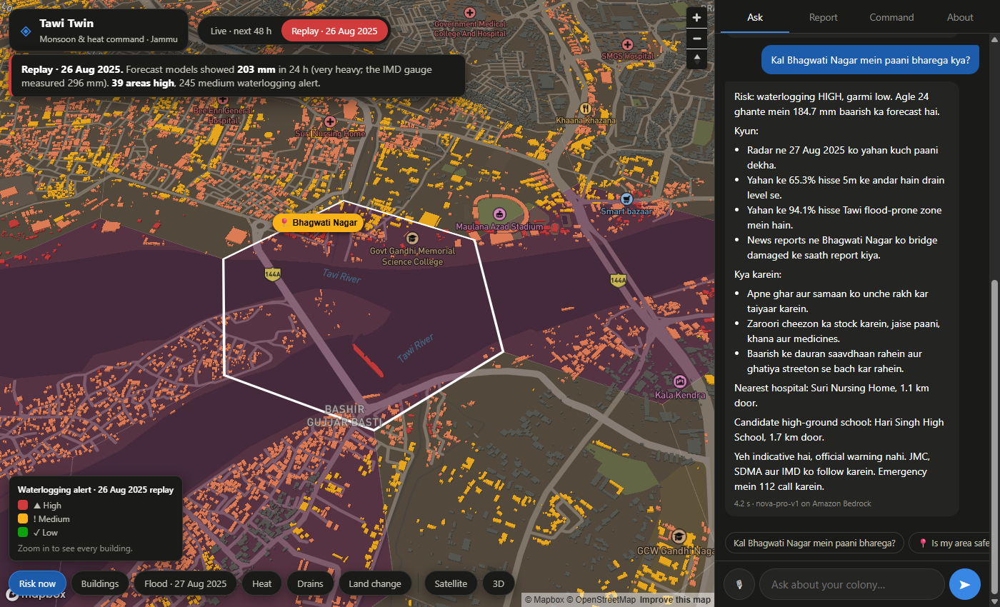
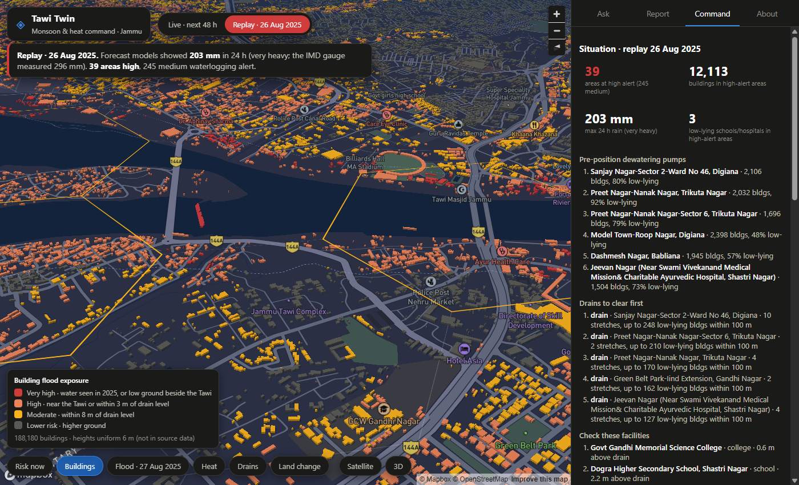
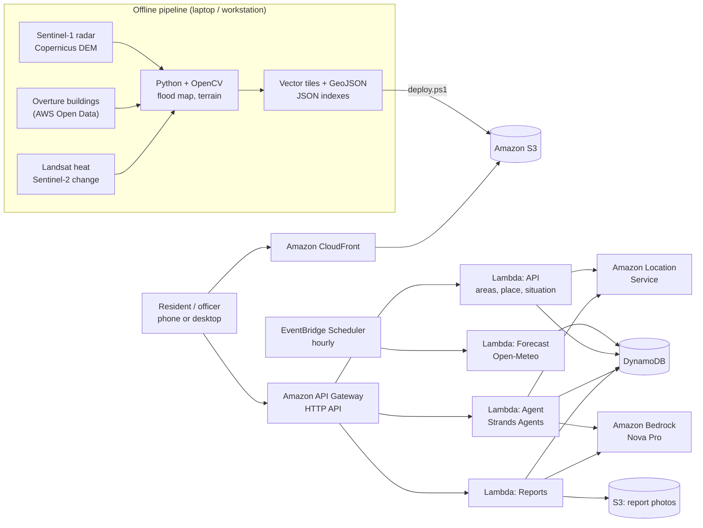

<div align="center">

# 🌧️🏙️ Tawi Twin

### *"Kal paani bharega?" Jammu finally gets an answer.*

**Monsoon and heat command for Jammu, building by building.** Ask in Hindi, Hinglish or English, and get the 48-hour flood and heat risk for *your* street, plus what to do about it.

[](https://d2r8k00l2fxqnu.cloudfront.net)
[](https://youtu.be/7ypGLr-2Zvk)
[](docs/blog.md)


<a href="https://youtu.be/7ypGLr-2Zvk"></a>

*▶ Click to watch the film*

**👉 Try it:** hit **Replay the flood**, then ask *"Kal Bhagwati Nagar mein paani bharega?"*



</div>

---

## 🌊 The night Jammu flooded

On **26–27 August 2025** Jammu received a record **296 mm of rain in 24 hours** (previous record 272.6 mm, 1973).
The Tawi crossed its highest flood level, part of the **4th Tawi Bridge at Bhagwati Nagar** gave way, and
5,000+ people were evacuated from low-lying localities such as Peerkho, Nikki Tawi, Gujjar Nagar and Beli Charan.
Residents had no street-level warning, and the city had no ranked list of where to send pumps or which drains to clear.
Jammu also bakes in June: summer ground temperatures in the hottest neighbourhoods exceed 45 °C.

## 🙋 Who it helps

| Who | Before | With Tawi Twin |
|---|---|---|
| **A resident** in a low-lying colony | Hears about flooding from neighbours, after the fact | Asks in Hindi, Hinglish or English (typing or voice): *"kal paani bharega?"* Gets the 48 h risk for **their** area, why, what to do, the nearest hospital and a high-ground school. Shares it on WhatsApp in one tap. Reports waterlogging with a photo. |
| **The control room** (JMC / Smart City ICCC) | Reacts to calls | Sees, before the rain, how many areas and buildings are at risk, where to **pre-position dewatering pumps**, which **drains to clear first**, which low-lying schools/hospitals to check, and an inbox of citizen photos **already triaged by AI**. |
| **The planning wing** | No ranked list | Pre-monsoon priorities weighted by **how many people live there**, exportable as CSV. |

## ✨ What it does

- 💬 **Ask Tawi Twin:** an agent on **Amazon Bedrock** (Strands Agents) that finds any colony (Amazon Location Service),
  pulls the evidence (radar flood history, terrain, heat, news reports), checks the live forecast and answers in the
  user's language. It also drives the map: flies to the area, pins the place, opens its card.
- 🚨 **Risk now:** every one of 284 areas (~0.74 km² hexagons) gets a waterlogging and heat alert for the next 48 h,
  refreshed hourly from Open-Meteo using IMD rainfall categories.
- ⏪ **Replay 26 Aug 2025:** the same rules run on archived forecasts for the flood day: 39 areas high, 245 medium.
- 🏘️ **188,180 buildings in 3D**, each coloured by flood exposure (radar water in 2025, height above the nearest drain,
  Tawi flood-prone belt) and heat.
- 🎛️ **Command board:** situation tiles, pump positions, drains to clear, facilities to check, citizen reports with status.
- 📸 **Citizen reports:** photo + GPS, triaged by a Bedrock vision model (waterlogging, depth, blocked drain, severity 1–5).



## ☁️ Architecture (all on AWS, ap-south-1 Mumbai)



| AWS | Used for |
|---|---|
| **AWS SAM** (open source) | Whole stack as one template (`template.yaml`) |
| **Strands Agents** (open source) | The chat agent and its 7 tools (`backend/agent/app.py`) |
| Amazon Bedrock | Agent reasoning and photo triage (Amazon Nova Pro; any Bedrock model via one parameter) |
| AWS Lambda (Graviton, arm64) | API, agent, reports, hourly forecast |
| Amazon API Gateway (HTTP API) | Public API with throttling |
| Amazon DynamoDB | Forecasts, alerts, citizen reports, rate limits (TTL) |
| Amazon EventBridge Scheduler | Hourly forecast refresh |
| Amazon S3 + CloudFront | Site, map layers, 1,315 building vector tiles, report photos (private, presigned) |
| Amazon Location Service | Finding colonies OpenStreetMap does not have (Bhagwati Nagar, Gujjar Nagar...) and naming areas |
| AWS Open Data | Overture Maps buildings (queried in place with DuckDB), Terrain Tiles for hillshade / 3D |

## 🎯 Does it match what happened?

We checked the localities that published reports named as inundated on 26–27 Aug 2025
([Onmanorama](https://www.onmanorama.com/news/india/2025/08/27/jammu-floods-over-3500-resuced-by-army-ndrf-personnel.html),
[Sphere India SitRep 02](https://www.sphereindia.org.in/sites/default/files/2025-09/SitRep_02-_J&K_Cloudburst,_Flood,_and_Landslide_28-08-2025[1].pdf),
[News On AIR](https://www.newsonair.gov.in/incessant-rains-wreak-havoc-across-jammu-division-in-past-40-hours)).
For the 8 inside the mapped area, buildings within 500 m:

| | Near reported localities | Whole city |
|---|---|---|
| High or very high flood exposure | **36.4%** | 24.6% |
| Very high | **2.9%** | 0.8% |

Clear hits: Nikki Tawi, Beli Charan, Bhagwati Nagar (64–67% high/very high). Misses: Gurkha Nagar, Qasim Nagar,
Rajiv Nagar, Peerkho (8–14%). Likely causes: the 30 m elevation model includes buildings, and the radar passed at
18:34 IST on 27 Aug, a day after the peak. Eight places is a sanity check, not an accuracy estimate. We did not tune
the model on them. Details: `scripts/validate_reports.py`, `data/derived/validation_2025.json`.


## 🚀 Run it yourself

```powershell
# AWS CLI v2 + SAM CLI, logged in, region ap-south-1; .env with OHSOME_API_KEY, OFFICER_KEY, MAPBOX_TOKEN (optional)
./scripts/deploy.ps1            # vendor agent deps, sam build + deploy, publish site, layers and tiles
./scripts/deploy.ps1 -SiteOnly  # republish the site only
.venv/Scripts/python -I tests/smoke_live.py   # 21 live checks: endpoints, validation, agent languages, injection
```

Data pipeline (re-runnable, in order): `port_landguard.py` → `build_areas.py` → `flood_event.py` → `buildings.py` →
`score_areas.py` → `buildings_risk.py` → `drains.py` → `export_backend_data.py` → `validate_reports.py`.

```
backend/   agent/ (Strands agent)  api/  forecast/  reports/  layer/python/ttcore (shared logic + data indexes)
tawitwin/  grid, STAC search, terrain (WhiteboxTools), SAR flood mapping (OpenCV)
scripts/   data pipeline, deploy, validation      site/  static web app (Mapbox GL / MapLibre)
tests/     live smoke test                        docs/  screenshots, blog, video script
```

## 🙏 Credits

- **Models:** the deployed agent and photo triage run on Amazon Nova Pro via Amazon Bedrock.
- **Data:** Copernicus Sentinel-1/-2 and DEM (ESA, via Microsoft Planetary Computer), USGS Landsat,
  © OpenStreetMap contributors (ODbL, via ohsome), Overture Maps Foundation (ODbL/CDLA), Open-Meteo (CC BY 4.0),
  Amazon Location Service. Basemap © Mapbox © OpenStreetMap.
- **Code:** MIT licence. Go build something that keeps people dry. 💙
